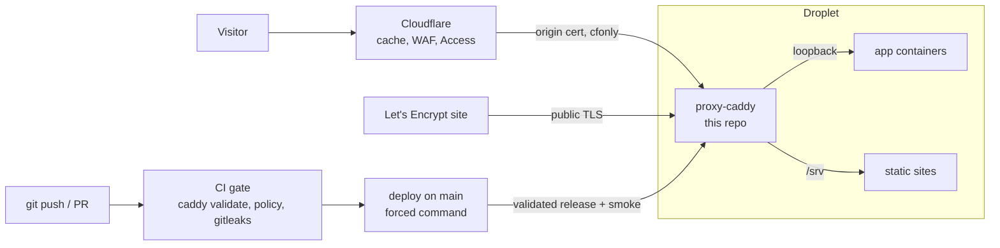

# webgooh-proxy

The edge config for a small shared server: one Caddy container in front of
several sites and apps, managed as code. Changes go through a pull request, a
validation gate, and an automatic deploy with rollback. Nobody edits the live
config on the server.

It is a real setup, not a demo: it routes 19 public hostnames on one host, most of
them behind Cloudflare, and it is what keeps them up.

## What it does



- **Origin lock.** Sites behind Cloudflare only answer requests that come from
  Cloudflare's published ranges. Anything else is aborted, so Access and the WAF
  cannot be bypassed by hitting the server directly. Every origin-certificate site
  imports the same `cfonly` snippet; the policy check fails if one does not.
- **Per-site headers.** Shared snippets set HSTS, `nosniff`, framing and referrer
  policy on static sites, strip server fingerprints, and cache hashed assets for a
  year while forcing HTML to revalidate.
- **Loopback only.** Apps listen on `127.0.0.1`. The policy check fails on any
  `reverse_proxy` upstream that is not loopback.
- **Validated GitOps deploy.** A pull request must pass `caddy fmt`,
  `caddy validate` in the exact image the host runs, the edge policy on the
  adapted JSON, a secret scan of the full history, and the host-script tests.
  Merges to `main` deploy through a forced command on the host.
- **Automatic rollback.** The host validates the new release inside the running
  container, switches atomically, reloads, then checks every hostname against
  `smoke/baseline.txt`. Any difference restores the previous release, compose and
  helpers, and fails the run. Drift (a release edited on the host) blocks a deploy
  before anything changes.
- **Least privilege.** The deploy key can run one script, `restrict`-ed in
  `authorized_keys`. The workflow runs only on pushes to `main` and manual dispatch
  from the owner, in an environment restricted to `main`. Pull requests and forks
  never receive secrets.

## Repository layout

| Path | Purpose |
| --- | --- |
| `Caddyfile` | Edge config for every hostname. |
| `docker-compose.yml` | The proxy container: pinned `caddy:2` digest, host network, read-only mounts. |
| `sites/` | Static helper pages Caddy templates from `/srv`. |
| `smoke/baseline.txt` | Expected HTTPS status per hostname, checked on the host after every deploy. |
| `scripts/check.sh` | The gate (format, validate, policy). Same script in CI and before each deploy. |
| `scripts/policy.sh` | Edge policy on `caddy adapt` JSON. |
| `scripts/deploy-proxy.sh` | Host-side forced command: install, switch, reload, smoke, roll back. `apply-env` applies a changed `proxy.env` the same way. |
| `scripts/test/` | Tests for the host script, run in CI with fake `docker` and `curl`. |

Not in this repo: TLS private keys (on the host only), and the release output of
each static site, which that site's own pipeline deploys.

## Host layout

```
/opt/proxy/
  docker-compose.yml      copy of the repo file (deploy-managed)
  proxy.env               host-only settings, root 0600, never in git (see below)
  deploy.log              one line per deploy, rollback and refusal
  config/                 mounted read-only as /etc/caddy
    current -> releases/<sha>   the live release (symlink swapped by deploys)
    releases/<sha>/       Caddyfile, docker-compose.yml, smoke/, sites/, MANIFEST.sha256
    certs/                origin certificate pairs (host-only)
  sites/                  mounted read-only as /srv (static roots)
```

The container runs `caddy run --config /etc/caddy/current/Caddyfile`. The mount is
the directory, so the symlink is resolved inside the container and a swap is
picked up on reload. Mounting `current` itself would pin the release that was
current at container start.

### Host-only settings (`proxy.env`)

`OPS_USER_{1,2,3}_{EMAIL,USERNAME,FULL_NAME}` are the named operator accounts.
Both panels use the same keys: the metrics vhost passes the Access email through
to Beszel only when it equals one of the `OPS_USER_n_EMAIL` values (exact match;
anyone else is shown the shared viewer), and the Cronicle identity page answers
with that user's username and full name. They are kept out of git on purpose. The
file is `/opt/proxy/proxy.env`, mode `0600`, owned by root, and is passed to the
container with `env_file`. Caddy substitutes the values when it loads the config.
CI uses dummy values (`ops{1,2,3}@example.invalid`), so validation never sees the
real list, and the edge policy refuses any regex, empty or wildcard match on the
Access email header.

The file is rendered by `infisical-agent` from Infisical (`droplet-deploy`, `prod`,
`/proxy`). To change a value, change it in Infisical. Within a minute the agent
re-renders the file and runs `deploy-proxy apply-env`, which:

1. does nothing if the file's hash equals the last applied one;
2. refuses an empty render, and a render it already rejected;
3. runs `caddy validate` on the current release in a throwaway container with the
   same image, mounts and `env_file` (`docker compose run`);
4. recreates `proxy-caddy` (Caddy reads env only at container creation) and
   smokes every hostname against the current release's `smoke/baseline.txt`;
5. on any failure puts the last applied `proxy.env` back (kept as
   `/var/lib/infisical-agent/proxy.env.applied`), recreates again if it had
   already recreated, and logs `apply-env: ROLLBACK` to `deploy.log`. Fix the
   value in Infisical; the next render is tried again.

It takes the deploy lock, so it never runs alongside a deploy. The deploy key
cannot trigger it: the forced command gets no arguments.

## Add a site

1. Put the TLS material for the domain under `config/certs` on the host, or use
   `tls internal` / Let's Encrypt if the domain is not behind Cloudflare.
2. Add the site block to `Caddyfile`. If it is behind Cloudflare, `import cfonly`.
   Use `reverse_proxy 127.0.0.1:<port>` for apps, or `root * /srv/<name>` for static
   sites (ship the files into `/opt/proxy/sites/<name>` through that site's own pipeline).
3. Add the hostname and its expected status to `smoke/baseline.txt`. Get the status
   on the host: `curl -sk -o /dev/null -w '%{http_code}' --resolve host:443:127.0.0.1 https://host/`.
4. `scripts/check.sh` locally. Open a PR. The job summary lists added and removed
   hostnames. Merge, and the deploy runs.

The policy check fails if a hostname appears without a baseline entry, or if a
Cloudflare-proxied site lacks the origin lock.

## Roll back

Automatic: a failed reload or smoke test rolls back on the host and the run fails.

Manual, to any commit already on `main`:

```
gh workflow run deploy.yml --repo Jubstaaa/webgooh-proxy --ref main -f ref=<commit-sha>
gh run watch --repo Jubstaaa/webgooh-proxy
```

The workflow refuses commits that are not on `main`. The release directories
kept on the host are the last 10, plus the current and previous one, so any recent
commit redeploys with no rebuild.

## Emergency (GitHub or the deploy path is down)

Only if `deploy-proxy` cannot run. As root on the host:

```
cd /opt/proxy
ls config/releases                                  # choose a known-good release
ln -s releases/<good-sha> config/.current.next && mv -T config/.current.next config/current
docker exec proxy-caddy caddy reload --config /etc/caddy/current/Caddyfile --adapter caddyfile
echo "$(date -u +%FT%TZ) MANUAL current -> <good-sha>" >> deploy.log
```

Then fix `main` through a PR and redeploy it. Never edit a file under
`config/releases/` in place: the next deploy refuses it as drift.

## Secrets and settings

| Name | Where | What |
| --- | --- | --- |
| `PROXY_DEPLOY_HOST` | repo secret | Address of the host, used only by `deploy.yml`. |
| `PROXY_DEPLOY_KNOWN_HOSTS` | repo secret | Pinned host key for that address. |
| `PROXY_DEPLOY_SSH_KEY` | repo secret | Private key for the forced command. Only the public half exists on the host. |
| `OPS_USER_{1,2,3}_{EMAIL,USERNAME,FULL_NAME}` | Infisical `droplet-deploy` / `prod` / `/proxy`, rendered to `/opt/proxy/proxy.env` | Named operator accounts for the metrics panel and the Cronicle identity page. |

The host's `authorized_keys` entry for the deploy key is
`restrict,command="/usr/local/bin/deploy-proxy"`. `restrict` disables pty,
forwarding and agent use. To rotate: add a new key line, update the secret, deploy,
then remove the old line.

The host script `/usr/local/bin/deploy-proxy` is a copy of `scripts/deploy-proxy.sh`,
installed by hand as root when the script itself changes (deliberately not by the
deploy: a release that could replace its own forced command would turn the deploy
key into root on the host). Install it from `main` after the PR merges. Check with
`cmp /usr/local/bin/deploy-proxy scripts/deploy-proxy.sh` from a checkout.
